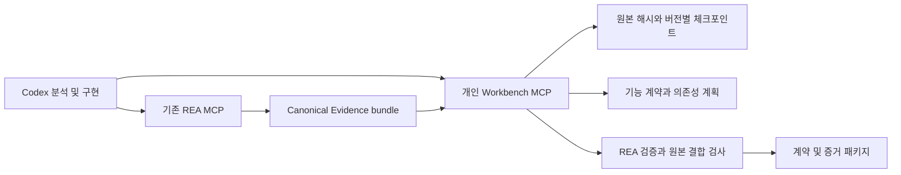

# Personal REA Workbench 0.1

## 제품 구조와 조사 결과

공식 REA를 분석 엔진으로 유지하고 개인 작업 계층을 `personal/workbench/`에
분리한다. Codex가 기존 REA 도구로 조사·재구현을 수행하고, Workbench가
프로젝트의 원본 정체성, 증거, 기능 계약, 작업 순서와 검증 결과를 보관한다.
새로운 모델 API나 별도 에이전트 프레임워크는 필요하지 않다.

2026-10-23 확인 기준:

| 대상                                                                                                                      | 실제 진행 상태                                                                                                          | 채택할 설계                                               | 이번에 포함하지 않은 부분                              |
| ------------------------------------------------------------------------------------------------------------------------- | ----------------------------------------------------------------------------------------------------------------------- | --------------------------------------------------------- | ------------------------------------------------------ |
| [RE-Agent](https://github.com/heaven-hm/re-agent/tree/a84c61e8baa65d445485722420a57ff4132b90d3)                           | 체크포인트, 앱 그래프, 의존성 스케줄러와 Binary Ninja 어댑터 구현. develop은 공식 6.7.0보다 969커밋 뒤이며 최근 CI 실패 | 원본 해시에 묶인 체크포인트, 의존성·순환·미해결 작업 표시 | 오래된 엔진 전체 병합, 미검증 Binary Ninja 설치        |
| [RECarve 0.44.0](https://github.com/LuckyFishOno/reverse-engineering-carve/tree/5ee4f1d7ed9bb03f9f7593cf9e1ccbe52cadd29d) | 기능 계약, 파일 해시 결합, 원본/후보의 제한된 사례 비교, 기능 패키지 관리. native/mobile은 실험 범위                    | 기능별 명세, 근거가 있는 검증, 계약·증거 패키지           | 범용 네이티브 앱 자동 복원, 외부 구현 코드의 일괄 편입 |
| [공식 REA 6.7.0](https://github.com/morluto/rea/releases/tag/rea-agents-6.7.0)                                            | 현재 개인 포크의 분석 엔진                                                                                              | 기존 artifact 검사, canonical Evidence, 비교·검증 계약    | 미배포 main의 무조건 추종                              |

RE-Agent의 정수 변환·Calculator 벤치마크는 제한된 입력 사례의 결과다.
전체 앱 복구 증명이 아니며 LLDB 시간 초과 및 정리 실패 사례도 기록돼 있다.
RECarve의 검증 기록도 서명 없는 로컬 기록이며 실행하지 않은 검사와 실제
원본/후보 비교를 구분한다. 두 프로젝트의 소스 설계를 검토했지만 해당 엔진의
실행 성능을 이 Mac에서 비교한 것은 아니다. 코드를 복사하지 않고 위 개념을
현재 REA 계약에 맞춰 구현했다. 자세한 조사는 [포크 조사](fork-research-20261023.md).



## 구현한 흐름

1. `project_create`: 파일·앱·설치 폴더·DMG·APK를 기존 REA로 정적 검사한다.
   프로젝트 디렉터리는 대상 밖에 새로 만든다. 원본 inventory와 root hash를 고정한다.
2. `project_checkpoint`: 기본 REA MCP의 `export_evidence_bundle` 결과를 가져온다.
   canonical parser와 기본 REA import로 내용 ID, manifest와 증거 연결을 검증한다.
   임의의 JSON에 적힌 성공 여부를 근거로 삼지 않는다.
3. `feature_define`: 원본 inventory에 존재하는 구성 요소 해시, 기능 설명, 선행
   기능과 유한한 비교 claims를 정의한다. 계약 변경이나 증거 추가 시 이전 판정을
   무효화하고 재검증한다.
4. `project_plan`: ready/blocked/verified, 누락된 의존성, 순환 관계와 검증 범위를
   짧게 반환한다. 순환 그룹은 자동 실행하지 않고 명세 분할·검토 대상으로 남긴다.
5. `artifact_compare`: 원본과 후보의 완전한 inspection Evidence를 비교하고
   structural-artifact claim을 만든다. 동일한 content ID만으로 독립 관찰을
   꾸미지 않으며, 같은 경로를 자기 자신과 비교하면 검증은 unknown일 수 있다.
6. `feature_verify`: 기본 REA의 `verify_reconstruction`을 호출한다. 각 claim의
   원본 측 증거가 선택한 구성 요소 해시를 직접 식별해야 한다. 연결이 부족하면
   unknown으로 둔다. 현재 동작 검증은 기존 REA에서 capture·compare한 증거를
   checkpoint로 가져와 behavioral claim으로 지정하는 방식이다.
7. `project_resume`: 원본을 재검사해 해시와 inventory manifest를 확인하고 저장된
   Evidence를 새 REA 세션에 복원한다. 디버거·프로세스·마운트 자체를 재개하지 않는다.
8. `project_export`: `project.json`, `evidence.json`, `plan.json`과 SHA-256 manifest를
   새 폴더에 저장한다. 패키지는 계약과 근거이며 실행 가능한 재구현 코드가 아니다.

원본이 바뀌면 별도 프로젝트를 만들어 버전을 비교한다. 과거 증거를 새 버전의
증거로 재명명하지 않는다. `project_plan`은 과거 체크포인트 상태이며 현재 대상이
그대로라는 판정은 `project_resume`으로 확인한다. 통과는 선언한 사례·차원에만
유효하다. 구조가 같다고 동작이 같다는 뜻은 아니다.

## 사용법

설치된 명령은 `rea-workbench`, 기존 엔진은 `rea`다. CLI와 MCP는 같은 service를 사용한다.
CLI 인자는 JSON 또는 `@input.json` 파일이다. 다음 경로는 사용자가 선택한 실제 경로로 바꾼다.

```sh
rea-workbench project_create '{"project":"/path/to/new-project","target":"/Applications/Example.app"}'
rea-workbench project_plan '{"project":"/path/to/new-project"}'
rea-workbench feature_define @feature.json
rea-workbench artifact_compare '{"project":"/path/to/new-project","feature_id":"inventory","candidate_path":"/path/to/candidate.app"}'
rea-workbench feature_verify '{"project":"/path/to/new-project","feature_id":"inventory"}'
rea-workbench project_export '{"project":"/path/to/new-project","destination":"/path/to/new-export"}'
```

`feature.json` 예시에서 `original_sha256`는 create 결과의 `target.sha256` 또는
원본 inventory에 들어 있는 실제 구성 요소 해시를 사용한다.

```json
{
  "project": "/path/to/new-project",
  "feature": {
    "id": "inventory",
    "title": "배포 구조 비교",
    "description": "재구성한 배포 폴더의 파일 구성과 내용을 원본과 비교한다.",
    "original_sha256": "REPLACE_WITH_ORIGINAL_SHA256",
    "depends_on": []
  }
}
```

직접 behavioral/function 검증을 할 때는 기본 REA에서 export한 bundle을
`project_checkpoint`에 전달한 다음 `feature.specification`에 기본 REA의
`verify_reconstruction` 명세를 넣는다. Workbench는 임의 프로그램 실행 도구를
추가하지 않는다. 대상 실행이 필요하면 실제 권한과 환경을 먼저 정하고 기본
REA의 기존 실행·정리 계약을 사용한다.

저장은 append-only `revisions/<sha256>.json`과 원자적으로 교체하는 `HEAD`로
구성된다. 디렉터리 lock으로 쓰기를 직렬화하고, 실패하면 기존 HEAD를 보존한다.
중단된 작업의 `.lock`은 자동으로 빼앗지 않는다. 실행 중인 작업이 없는지 확인한
후 해당 프로젝트의 lock만 수동 해제한다. 기록은 서명 없는 로컬 기록이며
악의적인 로컬 소유자에 대한 변조 방지 장치가 아니다. 전체 bundle을 revision마다
저장하므로 대형 프로젝트의 디스크 사용량은 증가한다. 압축·GC는 후속 범위다.
패키지에는 원래 경로와 분석 출력이 포함되므로 공유 전에 내용을 확인한다.

## 공식 버전 자동 추종

`personal/workbench/update.mjs --check`는 공식 GitHub stable release를 확인한다.
`--apply`는 다음 조건을 만족할 때만 개인 main과 실행 환경을 올린다.

- 공식 `morluto/rea`의 stable tag를 정확한 commit으로 고정한다. prerelease와
  개발 main은 자동 선택하지 않는다.
- 작업 중인 브랜치·미커밋 변경·변경된 원격 main은 덮어쓰지 않는다.
- 별도 detached worktree에서 기존 개인 main과 병합한다. 충돌 시 후보와 로그를
  남기고 현재 런타임을 유지한다.
- 고정 Node/npm 버전을 확인하고 `npm ci`, build, Workbench 실제 MCP/CLI 검사,
  업데이트 실패·동시 변경 회귀 검사, artifact/bundle 검사, 정적 검사와 docs 검사를 실행한다.
- 통과한 candidate commit과 깨끗한 작업 트리를 재확인하고 backup ref를 만든다.
  개인 main은 fast-forward만 허용한다.
- 검증한 worktree 자체를 설치 런타임으로 유지하고
  `~/.local/share/rea-personal/current` 심볼릭 링크를 원자적으로 전환한다.
  이전 런타임은 지우지 않는다. 마지막에 개인 GitHub main으로 push한다.

업데이트 스크립트는 **개발용 원래 checkout의 main**에서 실행한다. 설치용
worktree는 detached 상태이므로 거기에서 `--apply`를 실행하면 보류한다.
예상하지 못한 Node/npm 변경은 자동 설치하지 않고 이유를 보고한다. Ghidra,
Java, JADX와 다른 외부 프로그램도 자동 교체하지 않는다.

상태와 단계별 로그는 Git common directory의 `personal-updates/`에 남긴다.
검증 실패는 main과 런타임을 그대로 둔다. source 승격 뒤 링크 전환이나 push가
실패하면 receipt의 정확한 단계와 backup ref를 보고한다. 링크 교체 전이면 기존
런타임이 남고, push만 실패하면 로컬 검증 버전은 활성화된 상태다. 자동 hard reset,
강제 push, 충돌 덮어쓰기, npm 공개 배포는 하지 않는다.

이미 연결된 MCP 프로세스는 이전 버전을 계속 사용한다. 새 연결부터 새 런타임을
사용하므로 Codex의 MCP 재연결 또는 새 세션이 필요하다. 런타임을 보존하는 이유도
기존 분석 프로세스가 참조하는 파일을 지우지 않기 위해서다.

## 검증 및 다음 개발 단위

```sh
node --test personal/workbench/workbench.test.mjs personal/workbench/update.test.mjs
```

실제 core MCP/CLI를 사용하는 테스트는 원본·후보 폴더, 해시 결합, pass/fail/unknown,
체크포인트 재개, 변조 거부, 변경된 원본 거부, 패키지 hash, lock 경합을 검증한다.
실제 Git 테스트는 dirty/main 변경과 검사 실패 시 승격하지 않는지 확인한다.
CI에 Linux/macOS Workbench 계약 검사를 별도로 추가했다. Windows 런타임과
전체 앱 재구현은 이 검증의 범위가 아니다. 자동 업데이트의 로컬 통과는
GitHub 전체 CI나 모든 외부 제공자 검증 통과를 뜻하지 않는다.

다음 개발은 실제 사용 대상의 기능 하나를 골라 원본 입력·출력 사례를 수집하고,
Codex로 후보 모듈을 구현해 behavioral claims를 통과시키는 수직 흐름을 기준으로
진행한다. 이후 생성한 소스와 빌드 환경을 패키지에 결합하고, 반복 실패의 반례
축소, 순환 의존성 그룹 처리, 저장 공간 압축을 확장한다. 이 순서를 거쳐야
네이티브 앱·APK에서 확인하지 않은 자동 복구 능력을 과장하지 않으면서 발전시킬 수 있다.
